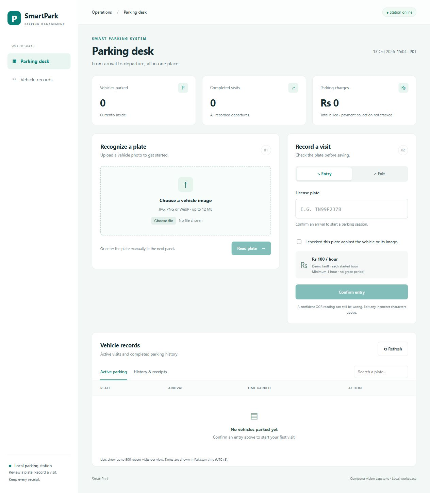

# Smart Car Parking System



A computer-vision capstone prototype for managing parking entry and exit. A local dashboard connects a custom-trained YOLO11n plate detector and EasyOCR with operator-confirmed parking records, fee calculation, and receipts.

> **Project status:** The local dashboard supports image upload, plate detection and OCR, editable plate confirmation, entry/exit, searchable records, charges, and browser-printable receipts. Live camera/video processing and broader OCR evaluation remain to be built.

## What it does

The current API accepts an image and returns detected plate bounding boxes and confidence scores; optional OCR returns candidate plate text and a review flag. The intended end-to-end workflow is:

```text
Entry/exit image or video → plate detection → OCR → parking session → fee and receipt
```

The detector only locates plates; it does not read the characters yet. The training labels contain plate bounding boxes, not plate text.

## Model and evaluation

YOLO11n was fine-tuned for 30 epochs using a Tesla T4 in Google Colab. The report keeps validation and held-out test results separate:

| Split | Images | Plate instances | Precision | Recall | mAP@50 | mAP@50–95 |
|---|---:|---:|---:|---:|---:|---:|
| Validation | 141 | 157 | 0.922 | 0.866 | 0.914 | 0.634 |
| Held-out test | 199 | 274 | 0.938 | 0.763 | 0.824 | 0.575 |

The test set is held out from training. The lower test recall indicates that some plates are missed on unseen examples; this is an area for improvement. Training evidence and the dataset audit are saved in [`evidence/`](evidence/).

## Tech stack

- **Object detection:** Ultralytics YOLO11n
- **API:** FastAPI and Uvicorn
- **Image handling:** Pillow
- **Training:** Google Colab with a Tesla T4 GPU
- **Inference:** CPU supported; a local GPU is not required
- **Implemented in API:** optional EasyOCR plate text extraction
- **Parking records:** SQLite sessions, fee calculation, and JSON receipts
- **Interface:** responsive HTML/CSS/JavaScript dashboard served by FastAPI; no frontend build or separate server
- **Receipts:** view saved visits and print or save as PDF through the browser

## Run the plate detection API

The API expects a trained checkpoint named `best.pt` in the repository root. The checkpoint and dataset are kept out of Git; this repository cannot run plate detection until you supply the checkpoint. Train one using the included Colab notebook and your labeled dataset, then download `best.pt` to the project root. The project author's existing local checkpoint also works.

Clone the repository first:

```powershell
git clone https://github.com/ridahafeez786/Smart-car-parking-system.git
cd Smart-car-parking-system
```

From a PowerShell terminal opened at the repository root:

```powershell
py -3.12 -m venv .venv
.\.venv\Scripts\python.exe -m pip install --upgrade pip
.\.venv\Scripts\python.exe -m pip install -r backend\requirements.txt
.\.venv\Scripts\python.exe -m uvicorn backend.main:app --reload
```

If Python 3.12 is not installed, use another Python version supported by the installed PyTorch and Ultralytics packages. Open **<http://127.0.0.1:8000/>** to use the dashboard. Upload a photo, click **Read plate**, select a plate if several are detected, and correct any OCR errors. Choose **Entry** or **Exit**, check the confirmation box, then save. Active visits appear below; **Check out** prepares an exit for a selected visit. Completed visits include a receipt with **Print / Save PDF**. Manual plate entry is also supported.

The initial demo rate is PKR 100 per started hour with a one-hour minimum and no grace period. Timestamps are displayed in Pakistan time; stored timestamps use UTC. Records persist in the local SQLite database. API documentation remains at <http://127.0.0.1:8000/docs>. The current UI accepts images; live camera/video input is not implemented.

## Automated checks

```powershell
.\.venv\Scripts\python.exe -m unittest discover -s tests -v
```

GitHub Actions runs the parking tests on pushes and pull requests. These check plate confirmation, duplicate entries, persistence, billing boundaries, repeated exits, receipt access, and summary totals. The checks do not need a GPU, dataset, or model weights; they do not measure model accuracy.

## Train the detector

The Colab training notebook is [`notebooks/train_plate_detector_colab.ipynb`](notebooks/train_plate_detector_colab.ipynb). It uses the cleaned YOLO dataset and saves `best.pt`. Keep the test split for final evaluation; use the validation split when comparing training settings or confidence thresholds.

The dataset is not included in this repository. It contains third-party vehicle images; check its license and permissions before redistributing it. The cleaned local copy, archive files, model weights, and training outputs are ignored by Git.

## Repository layout

```text
backend/                 FastAPI detection and parking services
backend/static/          Dashboard HTML, CSS, and JavaScript
evidence/                Training evidence and dataset audit summary
scripts/                 Dataset preparation and audit utilities
notebooks/               Training notebook
```

## Limitations and next work

- Evaluate OCR against manually transcribed plates and review uncertain readings.
- Add a tariff settings interface and live camera/video capture.
- Add direct PDF downloads if needed; current PDF saving uses the browser print dialog.
- Evaluate OCR and the complete entry-to-exit workflow on separately labeled examples.
- Improve missed detections using validation-set analysis, then report final results once on the held-out test set.

This is an academic prototype, not a production access-control system. Detection errors should be reviewed before charging a vehicle.
